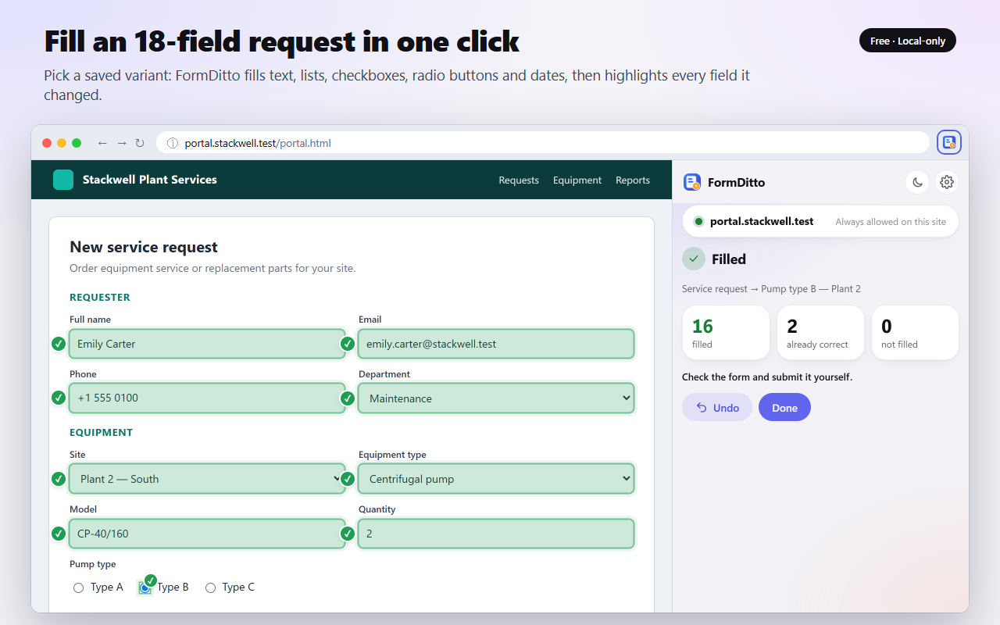

# FormDitto — Form Filler & Autofill Templates

A Chrome / Edge (Manifest V3) extension for people who submit the same kind of web form every day: service requests, orders, tickets, registrations. Record the form once as a **template**, keep a **variant** of values for every case ("Pump type B", "Pump type C"…), and fill the whole form in one click. Everything stays on your device: no server, no account, no analytics, no subscription. You always submit the form yourself.



## How it works

1. Open your form and click the FormDitto icon. The side panel opens next to the page.
2. **New template** → click the fields you need on the page (or **Add all visible fields**) and type their values on the page or in the panel; both stay in sync. The values become the first variant.
3. Add more variants: copy and edit them in the panel, or save what you filled in by hand with **New variant from page**.
4. Next time: pick a variant → **Fill** → check the preview ("field: now → new") → **Fill fields**. Changed fields are highlighted, and **Undo** puts the previous values back.

The first click on the icon gives access to that tab only. **Always allow on this site** asks Chrome for access to exactly that one site, so the panel works there without the extra click; access can be removed in the settings.

## What it fills

- Text, e-mail, phone, URL, number and search fields, text areas
- Drop-down lists, checkboxes, radio buttons, date and time fields
- React and Vue forms (controlled inputs get real `input` / `change` events)
- Lists and fields that load later: FormDitto waits for them (5 s by default, adjustable)
- Same-site iframes and open shadow DOM (web components)

## Security

FormDitto never submits a form, never records or fills passwords, payment card fields, one-time codes or hidden fields, and makes no network requests. Each template is tied to the site where it was recorded: on any other site — for example a look-alike copy of your portal — the preview shows a clear warning and filling needs an explicit confirmation.

The threat model and the tests that cover each threat are in [SECURITY.md](SECURITY.md).

## Develop

Requirements: Node.js 20+. There are no runtime dependencies; dev dependencies (Playwright, plus React and Vue for the test pages) are pinned to exact versions.

```bash
npm ci
npx playwright install chromium
npm test           # unit tests (node --test) + end-to-end tests (Playwright, the unpacked extension in Chromium)
npm run build      # dist/formditto-<version>.zip, deterministic
npm run check      # npm audit + all tests + build
npm run store      # store icon, screenshots, promo tiles and demo video, captured from the real UI
```

Load unpacked: `chrome://extensions` → Developer mode → Load unpacked → `extension/`. Chrome or Edge 116+.

If Playwright's Chromium does not start on Windows (`spawn UNKNOWN`, "side-by-side configuration is incorrect"), the terminal is probably an app from the Microsoft Store, which virtualises `%LOCALAPPDATA%`. Install the browser into the project folder and run the tests with the same variable:

```bash
PLAYWRIGHT_BROWSERS_PATH=.browsers npx playwright install chromium
```

The end-to-end tests load a copy of `extension/` whose manifest also grants `127.0.0.1` and `localhost`, because Playwright cannot click the browser's own permission prompt or toolbar icon. The code is the same; the release manifest is checked separately, and the build refuses to package a manifest with `host_permissions`.

### Translations

The UI ships in 14 languages: English, German, Spanish, French, Italian, Dutch, Polish, Portuguese (Brazil), Turkish, Ukrainian, Russian, Japanese, Korean and Simplified Chinese. It follows the browser language and can be changed in the settings. Strings live in `scripts/i18n/<locale>.mjs` (`en.mjs` is the source of keys); `node scripts/i18n-src.mjs` regenerates `extension/_locales/` and `extension/lib/locales.js`. Store descriptions are in `store/descriptions/`.

## Layout

```
extension/            what goes to the store
  manifest.json       MV3: activeTab, scripting, storage, sidePanel; optional host permissions
  background.js       toolbar click → side panel
  sidepanel.*         UI: templates, variants, recording, preview, fill, undo, settings
  content/agent.js    page agent (isolated world): field discovery, field policy, filling
  lib/                strict import schema, storage, origin checks, messages, DOM helpers, i18n
test/pages/           test forms: portal, React, Vue, dynamic lists, iframes, shadow DOM, traps, XSS
test/unit, test/e2e   tests; tests for a threat carry its id ([T1]…[T14]) in the title
scripts/              build, store assets, icons, translations
store/                store listing, permissions, privacy policy, icon, screenshots, tiles, video
```

## Limitations

- Closed shadow DOM and cross-origin iframes are not supported (by design).
- Custom drop-downs that hide the native `<select>` (select2, MUI Select) cannot be filled: hidden fields are off limits.
- `select multiple`, `contenteditable` and file uploads are not supported.
- Multi-step wizards: fields of a step that is hidden when the template is saved are not recorded — use one template per step. FormDitto never clicks "Next".
- A field the site deletes and recreates stays in a recording only if the new element has the same id, name and label.
- Undo cannot clear a radio group that had nothing selected before the fill (a person cannot either, and forcing it breaks React/Vue state); it does restore a previous choice.

## Privacy

FormDitto handles the form data you choose to save (field labels from the page and the values you enter, such as names, e-mail addresses or phone numbers) only to fill your forms. It keeps that data in the browser's local extension storage on your device: it is never transmitted, sold or shared, and the extension makes no network requests. Full policy: [store/PRIVACY.md](store/PRIVACY.md).

FormDitto's use of the data it handles adheres to the [Chrome Web Store User Data Policy](https://developer.chrome.com/docs/webstore/program-policies/), including the Limited Use requirements.
